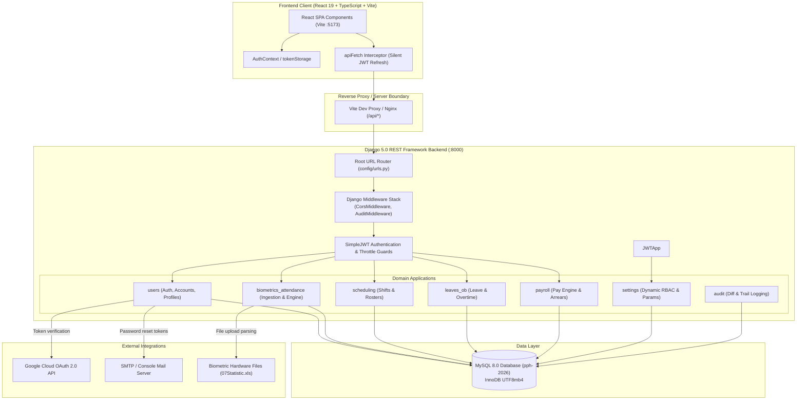
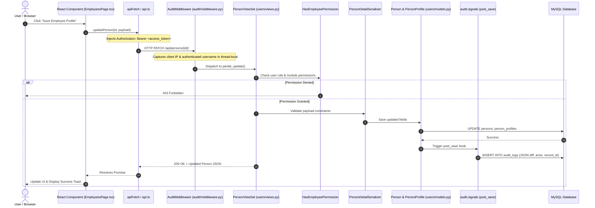
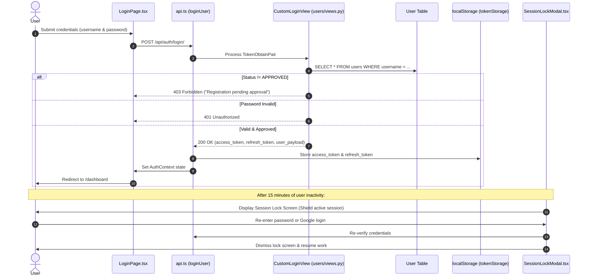
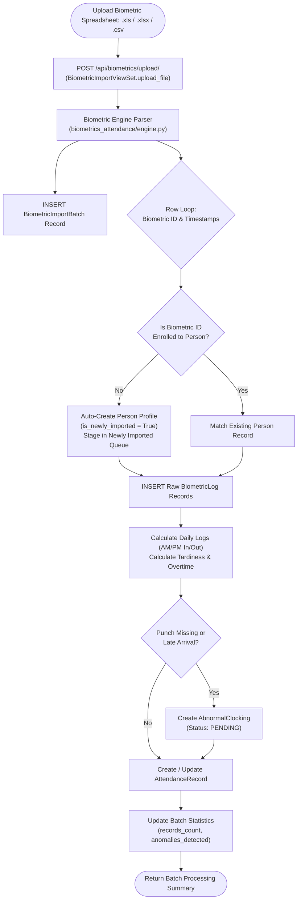
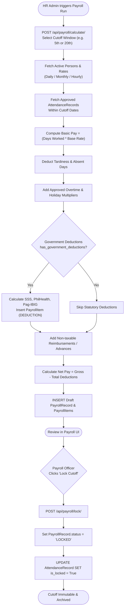
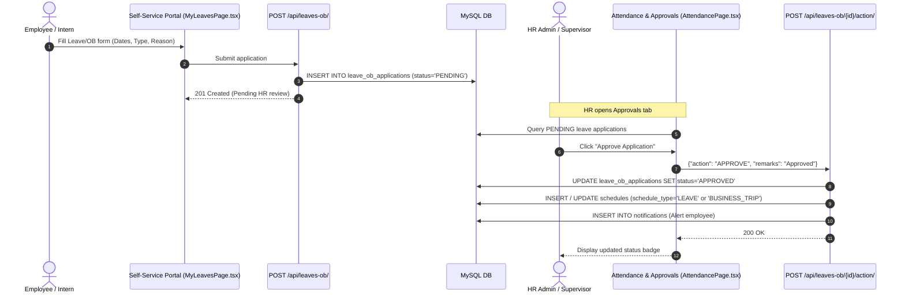
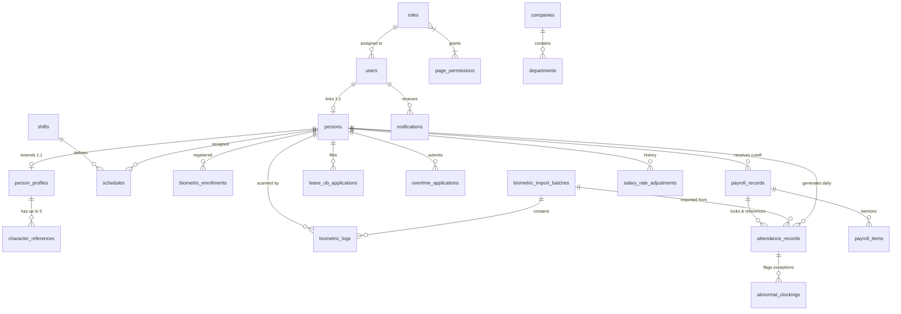

# PPHAdmin System Architecture & Workflow Diagrams

Visual flows and architectural interaction models for PPHAdmin.

---

## 1. High-Level System Architecture

---

## 2. API Request Lifecycle

Representative sequence of an authenticated mutating API request (e.g. Updating an Employee record or Filing a Leave):

---

## 3. Authentication & JWT Token Lifecycle

---

## 4. Key Business Domain Flows

### 4.1. Biometric Import & Anomaly Processing

---

### 4.2. Salary & Payroll Cutoff Generation

---

### 4.3. Leave & Official Business (OB) Filing & Approval

---

## 5. Core Data Entity Relationships

